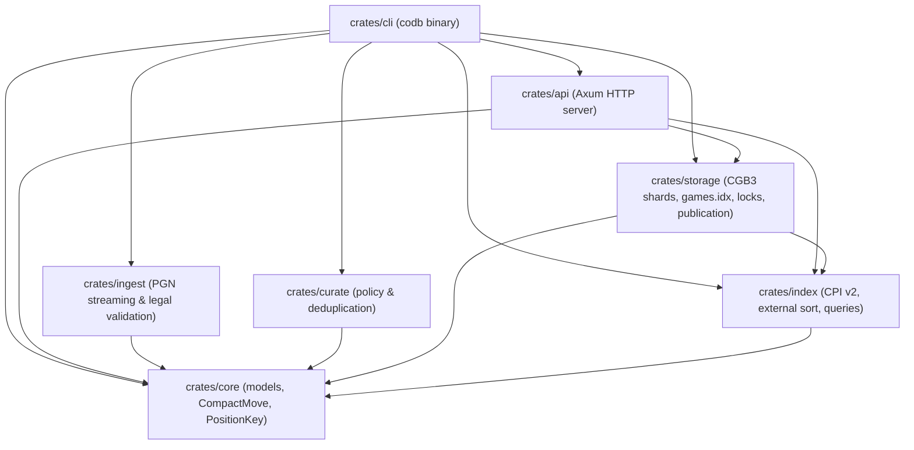
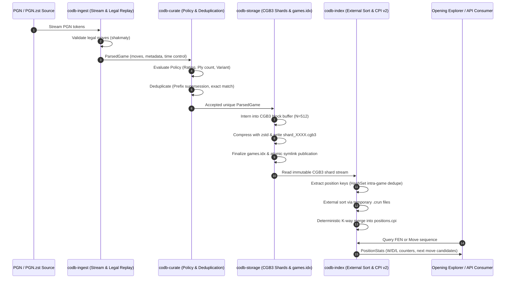
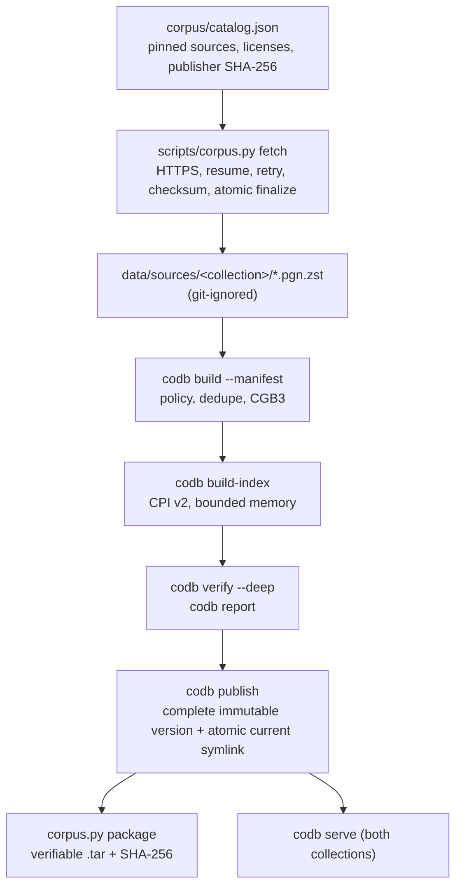
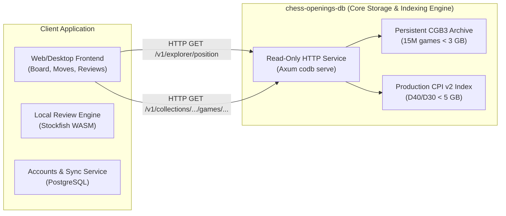

# System Architecture (`chess-openings-db`)

## 1. Executive Overview

`chess-openings-db` is a modular, high-performance chess database and position indexing engine written in Rust. It ingests large, heterogeneous PGN corpora, enforces strict legal move validation, canonicalizes headers, eliminates duplicates with prefix-supersession, stores compressed games in persistent sharded CGB3 containers, and builds immutable Compact Position Indexes (CPI v2) using bounded-memory external sorting.

The architecture is designed around explicit resource bounds:
- **Streaming Ingestion Memory:** measured peak RSS remains below the 30 MB target for the verified releases; platform-specific builds must be measured independently.
- **Position Indexing Memory:** peak accumulation is bounded by the --memory-limit-mib option (default 128 MiB, configurable down to 16 MiB).
- **HTTP Runtime:** Compose applies a 512 MiB memory cap, a 2 CPU quota, bounded request and reader-pool timeouts, and a reader-pool capacity of 1–64 per snapshot.
- **Current Release Footprint:** exact corpus and container measurements are recorded in [CORPUS_BUILD.md](CORPUS_BUILD.md). The historical 15-million-game projection is research only, not a current deployment target.

---

## 2. Workspace Crate Boundaries

The workspace comprises seven decoupled crates within `crates/`:

```
crates/
├── core/       # [codb-core] Fundamental domain types, move packing, and invariants
├── ingest/     # [codb-ingest] Streaming PGN parsing and full legal move replay
├── curate/     # [codb-curate] Policy filtering, header canonicalization, and deduplication
├── storage/    # [codb-storage] CGB3 container, sharding, atomic publishing, and locking
├── index/      # [codb-index] Position extraction, external merge sort, and CPI v2 indexer
├── api/        # [codb-api] Production-ready read-only HTTP Opening Explorer service
└── cli/        # [codb-cli] CLI binary (codb), command dispatch, and verification tools
```



### 2.1 `codb-core`
- **Location:** [`crates/core/`](../crates/core/)
- **Responsibilities:**
  - `Collection`: Strictly distinguishes `MastersOtb` from `EliteOnline`.
  - `CompactMove`: 16-bit bit-packed move representation (`from`: 6 bits, `to`: 6 bits, `promotion`: 4 bits).
  - `PositionKey`: 128-bit canonical Zobrist-like position hash capturing board squares, side to move, castling rights, and en passant availability.
  - `GameResult`: Lenient parsing for `1-0`, `0-1`, `1/2-1/2`, and `*`.
  - `StableGameId`: Deterministic 64-bit FNV-1a hash computed over canonical metadata key and normalized move sequence.

### 2.2 `codb-ingest`
- **Location:** [`crates/ingest/`](../crates/ingest/)
- **Responsibilities:**
  - Streaming PGN parser built on `pgn-reader` with transparent Zstandard decompression (`.pgn` or `.pgn.zst`).
  - Strict legal move validation using `shakmaty`: every move in every game is executed on an internal legal board state. Games with illegal moves fail closed and are rejected.
  - Time control evaluation: computes estimated game duration ($T_{\text{est}} = \text{base} + 40 \times \text{increment}$) to filter out bullet/ultrabullet games.

### 2.3 `codb-curate`
- **Location:** [`crates/curate/`](../crates/curate/)
- **Responsibilities:**
  - `policy.rs`: Concrete collection rules (`MastersOtbPolicy` and `EliteOnlinePolicy`), Elo/rating thresholds, minimum plies, and variant rejection.
  - `dedupe.rs`: Normalized metadata keys (`White|Black|Year|Event|Round`), move sequence prefix comparison, and superseding detection.
  - Dual-mode deduplication backends: `DeduplicatorBackend::Memory` (for tests/fixtures) and `DeduplicatorBackend::Disk` (SQLite-backed catalog in staging for multi-million game scaling).

### 2.4 `codb-storage`
- **Location:** [`crates/storage/`](../crates/storage/)
- **Responsibilities:**
  - `format.rs`: CGB3 block container (`CODB-v3`), block-level dictionary interning, and Zstandard compression.
  - `shard.rs`: Multi-shard file management (`shard_XXXX.cgb3`), 32-byte header `CGCS`, block descriptors, and automatic shard splitting.
  - `lookup.rs`: Global memory-mapped binary search index (`games.idx`) providing 16-byte fixed-record random lookup by 64-bit ID.
  - `lock.rs`: Process-level advisory file locking (`.dataset.lock`) using `flock(LOCK_EX | LOCK_NB)` to serialize mutations while permitting concurrent readers.
  - `dataset.rs`: Dataset publication coordinator, staging directory management, atomic symlink swaps, snapshot isolation, and crash recovery.

### 2.5 `codb-index`
- **Location:** [`crates/index/`](../crates/index/)
- **Responsibilities:**
  - `position.rs`: Canonical position extraction (`extract_game_positions_detailed`), intra-game repetition tracking, game result aggregation, and CPI v2 format writer (`positions.cpi`).
  - `external.rs`: Bounded-memory external merge sort pipeline (`ExternalPositionIndexer`), temporary run file emission (`.crun`), and deterministic hierarchical K-way merge.
  - Opening Explorer query execution: sub-millisecond memory-mapped sparse index lookup and block decompression for SAN, UCI, and legal FEN inputs.

### 2.6 `codb-api`
- **Location:** [`crates/api/`](../crates/api/)
- **Responsibilities:**
  - Production-ready, asynchronous, read-only HTTP Opening Explorer service built on Axum 0.8 and Tokio.
  - Implements `/v1/explorer/position`, `/v1/collections/{collection}/games/{id}`, `/v1/collections`, `/health`, `/ready`, and `/v1/admin/reload`.
  - Zero-copy, lock-free concurrent query execution directly against memory-mapped CPI v2 indexes.
  - Snapshot isolation pinning immutable version directories (`versions/vX/`) and atomic zero-downtime hot-reloading via `parking_lot::RwLock<Arc<DatasetSnapshot>>`.
  - Pooled, bounded threadpool execution for Zstandard CGB3 game decompression without blocking asynchronous request loops.

### 2.7 `codb-cli`
- **Location:** [`crates/cli/`](../crates/cli/)
- **Responsibilities:**
  - Unified CLI command parsing via `clap`: `build`, `build-index`, `query`, `verify`, `inspect`, `report`, `get-game`, `bench`, and `serve`.
  - `codb build --report-json` and `codb report` emit machine-readable accounting, rejection-reason, and distribution reports consumed by the corpus release workflow.
  - Service daemon lifecycle management for `codb serve`, handling host, port, timeout, move ply limits, and graceful OS shutdown signals.
  - Progress reporting and structured JSON diagnostic output.
  - Benchmark harnesses and verification gates.

---

## 3. End-to-End Data Flow



---

## 4. Sharding and Persistent Layout

Datasets are packaged as self-contained directory trees under `versions/v_<timestamp>_<nonce>` and exposed through an atomic symlink (`current`):

```
dataset_dir/
├── .dataset.lock           # Advisory flock file serializing writers
├── current -> versions/v1  # Atomic symlink pointing to active snapshot
└── versions/
    ├── v1/
    │   ├── manifest.json   # Dataset manifest, SHA-256 digests, and collection info
    │   ├── games.idx       # Sorted 16-byte fixed-record memory-mapped global index
    │   ├── shard_0000.cgb3 # First compressed persistent game shard (CGCS header)
    │   ├── shard_0001.cgb3 # Additional shard if corpus exceeds shard split threshold
    │   └── positions.cpi   # Production Compact Position Index (CPI v2)
    └── .staging_XXXX/      # Isolated build directory for in-flight publications
```

### 4.1 Shard Architecture (`shard.rs`)
- **Magic Header:** `CGCS` (`0x43474353`, 4 bytes).
- **Format Version:** `1` (`u32`).
- **Header Size:** Fixed 32 bytes with zero-padded reserved space.
- **Block Layout:** Sequential dictionary-interned CGB3 blocks compressed with Zstandard.
- **Shard Splitting:** Shards split automatically at configurable thresholds (e.g. 500 MB or 500,000 games) to ensure manageable file sizes across cloud storage and filesystem boundaries.

### 4.2 Global Lookup Index (`lookup.rs`)
- **Record Size:** Exactly 16 bytes per game:
  - `game_id: u64` (LittleEndian FNV-1a hash)
  - `shard_id: u16`
  - `block_index: u32`
  - `game_index_in_block: u16`
- **Lookup Cost:** $O(\log N)$ binary search over memory-mapped memory, followed by reading a single block descriptor and decompressing the target CGB3 block.

---

## 5. Concurrency Model and Locking (`lock.rs`)

`chess-openings-db` provides strong concurrency guarantees:
- **Lock-Free Read Snapshots:** Readers resolve `current` to its target canonical path (e.g., `versions/v1`) and pin open file descriptors. Readers require no locks, will never block on concurrent writes, and see a 100% consistent immutable snapshot even during active publication.
- **Serialized Mutations via Advisory Flock:** Mutations (`build`, `build-index`, `recover`) acquire an exclusive lock on `.dataset.lock` via `flock(fd, LOCK_EX | LOCK_NB)`. If another mutation process holds the lock, incoming operations fail closed immediately with `StorageError::Lock`.
- **Atomic Symlink Publication:** New versions are completely staged in `versions/.staging_<pid>_<timestamp>_<nonce>`, verified with deep integrity checks, and published via atomic symlink swap (`rename(temp_symlink, current)`). Readers observing `current` never observe a partial or half-written state.
- **Bounded HTTP Reader Pool Concurrency:** The HTTP serving layer enforces strict capacity bounds on active CGB3 decompressing readers via an asynchronous semaphore (`tokio::sync::Semaphore`). Requests exceeding pool capacity wait safely without blocking Tokio runtime worker threads. Permits and reader instances are safely recycled or dropped under timeouts and cancellations.
- **Fail-Closed Snapshot Hot-Reloading:** Dynamic dataset reloads (`POST /v1/admin/reload` or Unix `SIGHUP`) validate replacement candidate snapshots deeply before activation (`verify_dataset` checksum check and CPI index verification). If candidate verification fails, the reload fails closed and the existing active snapshot remains 100% functional.
- **Administrative Access Control:** Administrative reload endpoints require explicit token authentication (`--admin-token`), reject cross-origin requests (`Origin` header present), and default to restrictive same-origin CORS.

---

## 6. Bounded-Memory Architecture

Memory limits are strictly enforced across all components:

| Component | Ingestion / Processing Strategy | Peak Memory Guarantee |
| :--- | :--- | :--- |
| **PGN Ingestion** | Streaming tokenization via `pgn-reader`, immediate legal validation | $< 30\text{ MB}$ RSS regardless of corpus size |
| **Deduplication** | Disk-backed SQLite index in staging directory | 256 KiB SQLite cache plus a 512 KiB staging-catalog cache; temp store is disk-backed |
| **CGB3 Storage** | Single active block buffer ($N = 512$ games) flushed to disk | $\approx 2\text{ MB}$ uncompressed block RAM |
| **Position Indexing** | External merge sort with partitioned `.crun` spill files | Strictly bounded by `--memory-limit-mib` (default 128 MiB) |
| **Opening Query** | Memory-mapped sparse index ($34\text{ B/entry}$) + single block cache | $< 10\text{ MB}$ query overhead |
| **HTTP Serving** | Bounded reader pool plus memory-mapped CPI/games.idx | Reader count and request waits are bounded; process RSS includes touched file-backed pages and is measured against the real releases |

> **Measured releases:** Build-step and container RSS measurements for the current releases are recorded in [CORPUS_BUILD.md](CORPUS_BUILD.md#92-build-performance-one-pass-kernel-rusage-and-workspace-sampling) and its Docker integration evidence.

---

## 6.1 Corpus Orchestration Layer (Outside the Rust Workspace)

Source acquisition and release assembly are deliberately **not** part of the Rust pipeline. They live in a thin Python orchestration layer that only invokes the existing `codb` CLI:



The orchestration adds no binary format and does not reimplement ingestion, curation, deduplication, storage, or index semantics. It builds in a private data/work/ workspace, deeply verifies a complete candidate, moves the immutable version under the stable data/releases/<collection>/versions/ root, and atomically replaces the relative current symlink. Previous versions remain in place for readers pinned to an older snapshot. See [CORPUS_BUILD.md](CORPUS_BUILD.md).

---

## 7. Docker Runtime Boundary

The multi-stage image contains the codb executable and runtime libraries only. It does not contain corpus releases, source archives, build workspaces, or Cargo caches. Compose mounts the stable Masters OTB and Elite Online release roots read-only, deeply validates both before readiness, and binds 0.0.0.0:8080 on the container network. It publishes no host port by default. Separate Compose projects can attach to the same external network and resolve the API by the codb service alias. Operational commands and CORS boundaries are documented in [DOCKER_DEPLOYMENT.md](DOCKER_DEPLOYMENT.md).

## 8. Integration Boundaries (Client Applications)



- **Domain Decoupling:** `chess-openings-db` has zero dependency on UI frameworks, Stockfish engine binaries, or account synchronization.
- **Local-First Independence:** Client applications function 100% locally in guest mode without requiring a running `chess-openings-db` service. When configured, client applications query the Opening Explorer HTTP API to annotate games with opening tree statistics and win/draw/loss frequencies.
