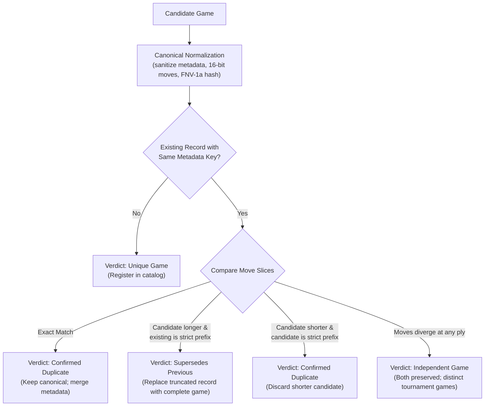

# Corpus Inclusion & Deduplication Policies

## 1. Zero Conflation Rule and Collection Isolation

The project strictly segregates two distinct curated game collections:
1. **`masters-otb`:** Over-the-board classical, rapid, and blitz games contested by titled grandmasters and verified masters in national/international championships, Olympiads, and historical master events.
2. **`elite-online`:** High-rated standard online games from platform rated archives contested by top-tier accounts under clean time controls.

> [!IMPORTANT]
> **Zero Conflation Principle:** Over-the-board FIDE Elo ratings and online platform Glicko-2 ratings are fundamentally incompatible metrics with different inflation rates, deviation dynamics, and player pools. They are **never** averaged, pooled, or combined into composite figures. Statistics and opening lines remain strictly isolated by collection.

---

## 2. Collection Inclusion Policies (`policy.rs`)

Implemented in [`crates/curate/src/policy.rs`](../crates/curate/src/policy.rs).

### 2.1 Masters OTB Policy (`MastersOtbPolicy`)
```rust
pub struct MastersOtbPolicy {
    pub min_both_elo: u16,               // Default: 2200
    pub min_one_elo: u16,                // Default: 2400 (IM/GM threshold)
    pub min_other_elo: u16,              // Default: 2000
    pub min_plies: usize,                // Default: 4 (2 full moves)
    pub allow_historical_pre_1970: bool, // Default: true
}
```

#### Acceptance Criteria
1. **Modern Era (Post-1970 FIDE Elo):**
   - Both players have FIDE Elo $\ge 2200$, OR
   - One player has FIDE Elo $\ge 2400$ and opponent has FIDE Elo $\ge 2000$.
2. **Historical Era Exception (Pre-1970):**
   - Official FIDE Elo lists did not exist prior to 1970. A pre-1970 game is accepted without Elo headers **only if the record names both the event and the venue** (`Event` and `Site` tags present and not `?`). A pre-1970 date alone is never sufficient (`HistoricalWithoutProvenance`). This is an executable check, not a statement of trust in the source: no historical archive is part of the pinned corpus catalog (see [CORPUS_BUILD.md](CORPUS_BUILD.md)).
3. **OTB Provenance (Online-Event Exclusion):**
   - Lichess broadcast archives also contain online events, and the PGN has no explicit over-the-board flag. A record is rejected (`OnlineEventInMastersSource`) when its `Event`, `Site`, or `BroadcastURL` contains the whole-word markers `online`, `internet`, `arena`, `bullet`, `ultrabullet`, `playchess`, `chesscom`, `tornelo`, mentions `chess.com`, or its `Site` is a plain Lichess game URL.
   - **Known limitation:** this is a marker heuristic over event metadata. It excludes records that announce themselves as online; it cannot prove that every remaining record was played over the board. Sources expose `provenance_confidence: medium` in the catalog for this reason.
4. **Move Legality & Orthodox Position:**
   - Standard orthodox starting position (`rnbqkbnr/pppppppp/8/8/8/8/PPPPPPPP/RNBQKBNR w KQkq - 0 1`) or verified orthodox legal custom FEN setup.
   - Chess960, Fischer Random, and custom handicap variants are rejected.
   - At least 4 plies (2 full moves) to exclude accidental aborts and trivial forfeits.

---

### 2.2 Elite Online Policy (`EliteOnlinePolicy`)
```rust
pub struct EliteOnlinePolicy {
    pub min_both_rating: u16,     // Default: 2200
    pub min_one_rating: u16,      // Default: 2400
    pub min_other_rating: u16,    // Default: 2000
    pub min_plies: usize,         // Default: 6 (3 full moves)
    pub exclude_bullet: bool,     // Default: true
}
```

#### Acceptance Criteria
1. **Rating Thresholds:**
   - Both players have verified online rating $\ge 2200$, OR
   - One player $\ge 2400$ and opponent $\ge 2000$.
   - Casual games are rejected (`CasualUnratedGame`) when the `Event` label contains `casual`. The Lichess *standard rated* archives contain only rated games, so this check is a defensive backstop.
   - **Provisional ratings:** The pinned Lichess PGN archives carry no provisional-rating marker, so this status cannot be distinguished from the exported Glicko-2 number and remains an explicit source limitation. Missing or unparsable ratings are rejected.
   - **Termination:** The reader checks PGN Termination values during curated ingestion. Aborted, Abandoned, Rules infraction, No contest, Unplayed, and Unterminated are rejected as AbortedOrInfraction; Normal and Time forfeit remain eligible. Unknown and missing values are not reinterpreted.
2. **Speed Category & Bullet Exclusion:**
   - **Bullet & UltraBullet are strictly excluded.** Extremely rapid time controls suffer from mouse slips, flag-hunting, and premoves that corrupt positional opening theory.
   - **Estimated Duration Formula:** Evaluated using estimated game length:
     $$T_{\text{est}} = \text{base\_seconds} + 40 \times \text{increment\_seconds}$$
   - Any game with $T_{\text{est}} < 180\text{ seconds}$ is classified as Bullet and rejected.
   - Valid accepted time controls: Blitz ($180\text{s} \le T_{\text{est}} < 600\text{s}$), Rapid ($600\text{s} \le T_{\text{est}} < 1800\text{s}$), and Classical ($T_{\text{est}} \ge 1800\text{s}$).
3. **Plies & Termination:**
   - Minimum 6 plies (3 full moves) to eliminate immediate resignations, disconnected connections, or pre-move blunders.
   - PGN Termination values that explicitly identify aborted, abandoned, unplayed, or rules-infraction games are rejected. Normal and Time forfeit are not rejected by this check.

---

## 3. Rejection Reason Taxonomy

When a candidate game is rejected during curation, it is classified into one of the following mutually exclusive categories (`PolicyRejectionReason`):

- `BelowRatingThreshold { white_elo, black_elo, reason }`: Fails rating criteria.
- `ProvisionalRating`: Player rating is provisional.
- `CasualUnratedGame`: Casual or unrated match.
- `BulletOrUltraBullet { event, time_control }`: $T_{\text{est}} < 180\text{ s}$.
- `TooFewPlies { plies, minimum }`: Game too short to reflect intentional opening play.
- `NonStandardVariant(String)`: Chess960, Crazyhouse, Antichess, King of the Hill, etc.
- `NonStandardStartingPosition(String)`: Illegal initial setup.
- AbortedOrInfraction(String): the curated reader rejects explicit aborted, abandoned, no-contest, unplayed, unterminated, and rules-infraction Termination values.
- `OnlineEventInMastersSource(String)`: Masters OTB only; the event, site, or broadcast URL carries an online-event marker.
- `HistoricalWithoutProvenance`: Masters OTB only; pre-1970 date without both event and venue.

### 3.1 Machine-Readable Rejection Categories

`PolicyRejectionReason::category()` maps every policy rejection onto a stable snake_case key used by `codb build --report-json` and the release `RELEASE/build_report.json` (`policy_rejection_reasons`): `below_rating_threshold`, `missing_rating`, `provisional_rating`, `casual_or_unrated`, `bullet_or_ultrabullet`, `too_few_plies`, `non_standard_variant`, `non_standard_start`, `aborted_or_infraction`, `online_event_in_masters_source`, `historical_without_provenance`. The reader's early policy filter reports through the same keys. The values sum exactly to `rejected_by_policy`. Variant and illegal-move rejections keep their own accounting counters (`rejected_variant`, `rejected_illegal`).

### 3.2 Curation Policy Version

Releases record `curation_policy_version` from the source catalog (`masters-otb/2026.11-r1`, `elite-online/2026.11-r1`). Revision `r1` introduced the Masters online-event exclusion, the historical-provenance requirement, and the Elite casual-event check. Datasets built before this revision (for example the PR-03 benchmark datasets) were curated without those three checks and are not directly comparable.

---

## 4. Deduplication and Identity Architecture (`dedupe.rs`)

Implemented in [`crates/curate/src/dedupe.rs`](../crates/curate/src/dedupe.rs).

Chess games cannot be identified solely by moves (opening transpositions frequently occur between different players in different tournaments) or solely by metadata (grandmasters contest multiple games in the same tournament). The deduplication engine resolves identity through a multi-key composite verification system:



### 4.1 Normalized Metadata Key (`NormalizedMetadataKey`)
Metadata fields are normalized to prevent spurious variations (e.g. spelling or whitespace) from hiding duplicates:
- **Player Names:** Sanitized to lowercase `lastname,firstinitial` format (e.g., `"Carlsen, Magnus"` $\to$ `"carlsen,m"`).
- **Year:** Extracted 4-digit calendar year (or blank).
- **Event:** Lowercase alphanumeric string with punctuation trimmed.
- **Round:** Standardized string.
- **Delimiter Sanitization:** Any pipe character (`|`) is replaced with `/` to prevent delimiter injection attacks in serializations.

### 4.2 Verification Decision Matrix

| Condition | Verdict | Action Taken | Guarantee |
| :--- | :--- | :--- | :--- |
| **Identical Metadata + Exact Move Slice Equality** | `ConfirmedDuplicate` | Discard candidate; keep canonical record. Merge metadata if candidate has richer fields. | Element-by-element equality check prevents 64-bit FNV-1a hash collision false positives. |
| **Identical Metadata + Candidate longer + Existing is strict prefix** | `SupersedesPrevious` | Replace existing truncated record with the full game. Atomically update lookup catalogs. | Strict prefix validation: `candidate.moves[..existing.moves.len()] == existing.moves`. |
| **Identical Metadata + Candidate shorter + Candidate is strict prefix** | `ConfirmedDuplicate` | Discard candidate; retain existing complete game. | Prevents broken live relays from degrading existing full game records. |
| **Identical Metadata + Moves diverge at any ply** | `TranspositionDifferentGame` | Accept both as distinct unique games. | Preserves blitz/rapid tiebreak games played between the same opponents in the same event. |
| **Identical Moves + Different Metadata** | `Unique` | Accept both as distinct unique games. | Preserves theoretical transpositions and opening novelties across different events. |

---

## 5. Deduplication Backends

1. **`DeduplicatorBackend::Memory`:**
   - In-memory hash maps (`HashMap<NormalizedMetadataKey, SeenGameRecord>`).
   - Optimized for fast test suites, deterministic fixtures, and CI validation.
2. **`DeduplicatorBackend::Disk`:**
   - Embedded SQLite catalog housed in the temporary build staging directory (`catalog.sqlite`).
   - Indexes metadata keys and move hashes on disk, fetching move sequences on demand for slice comparisons.
   - Keeps memory footprint strictly bounded ($< 64\text{ MB}$ SQLite cache) while processing multi-million game archives.
   - Automatically cleaned up upon dataset finalization.

---

## 6. Accounting Invariant (Fail-Closed Verification)

The ingestion and curation pipeline enforces a strict mathematical invariant. Across every run, all encountered games are accounted for in mutually exclusive, collectively exhaustive categories:

$$\text{total\_encountered} = \text{accepted\_unique} + \text{confirmed\_duplicates} + \text{superseded\_prior} + \text{rejected\_by\_policy} + \text{rejected\_variant} + \text{rejected\_illegal} + \text{rejected\_malformed} + \text{quarantined}$$

Furthermore, retained canonical games must match accepted unique games:
$$\text{retained\_canonical\_games} = \text{accepted\_unique}$$

If any counter diverges by even a single game, the pipeline fails closed, aborts publication, and sets `is_reconciled = false`.
