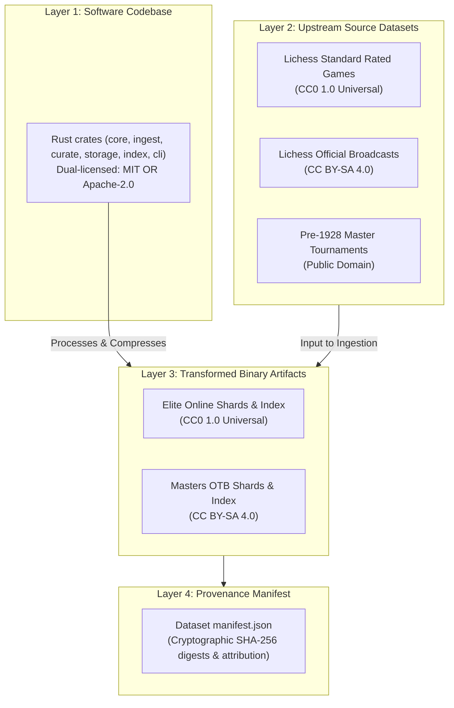

# Licensing and Data Provenance

## 1. Four-Layer Legal Architecture

To protect downstream consumers and maintain strict intellectual property boundaries, `chess-openings-db` segregates software logic, raw data inputs, compressed artifacts, and metadata provenance into four independent legal layers:

---

## 2. Software Codebase Licensing (`MIT` OR `Apache-2.0`)

All source code authored in this repository (`crates/core`, `crates/ingest`, `crates/curate`, `crates/storage`, `crates/index`, `crates/cli`, and associated build scripts) is dual-licensed:
- **[Apache License, Version 2.0](../LICENSE-APACHE)**
- **[MIT License](../LICENSE-MIT)**

Consumers and developers may use, embed, modify, and redistribute the software under either license at their option.

### Zero AGPL Code Reuse Principle
The reference Opening Explorer developed by Lichess (`lila-openingexplorer`) is licensed under the **GNU Affero General Public License v3.0 (AGPL-3.0)**.
- **Strict Clean-Room Boundary:** `chess-openings-db` contains **zero imported, translated, or derived code** from `lila-openingexplorer` or any AGPL codebase.
- All ingestion routines, binary container serialization (`CGB3`), external merge sort pipelines, and index querying engines were designed and authored independently from first principles.

---

## 3. Source Data Inventory and Classification Matrix

| Source | Publisher | Explicit License | Derivative Redistribution | Volume | Rating Pool | Classification |
| :--- | :--- | :--- | :--- | :--- | :--- | :--- |
| **Lichess Standard Rated Games** | Lichess.org | CC0 1.0 Universal | Unrestricted | >6 Billion | Lichess Glicko-2 | **Approved** (`elite-online`) |
| **Lichess Official Broadcasts** | Lichess.org | CC BY-SA 4.0 | Permitted with Attribution & ShareAlike | ~1.5 Million | FIDE Elo | **Approved** (`masters-otb`) |
| **Lichess Opening Names** | Lichess.org | CC0 1.0 Universal | Unrestricted | ~4,000 ECOs | N/A (Metadata) | **Approved** (ECO Reference) |
| **Pre-1928 Historical Archives** | Historical Public Domain | Public Domain | Unrestricted | ~150,000 | Historical Master | **Approved in principle; not in the pinned catalog** (a concrete archive with verifiable provenance is required before use) |
| **The Week in Chess (TWIC)** | Mark Crowther | Proprietary / Restricted | Prohibited without written license | ~3.5 Million | FIDE Elo | **Excluded** |
| **PGN Mentor** | Attila Schneider | Unspecified (Personal use) | Prohibited without license | ~1.8 Million | FIDE Elo | **Excluded** |
| **Caissabase** | Caissabase.co.uk | Ambiguous (TWIC derivative) | High legal risk | ~5.0 Million | Mixed / FIDE | **Excluded** |
| **KingBase 2019** | Community mirror | Ambiguous / CC BY-SA claimed | Upstream provenance unverified | ~2.2 Million | FIDE Elo | **Excluded / Deferred** |
| **FIDE Official PGN Relays** | FIDE | Proprietary / Terms vary | Requires event-by-event permission | Varies | FIDE Elo | **Requires Explicit Permission** |
| **Lumbra's Gigabase OTB Complete** | Lumbra's Gigabase | Publisher claims CC BY-NC 4.0; heterogeneous upstream records | Public redistribution not authorized; source-level rights are not cleared | >13 million (publisher claim) | Publisher-supplied Elo | **Private authorized evaluation deployment only; excluded from approved catalog** |

---

## 4. Dataset Licensing Framework & Redistribution Obligations

### 4.1 Elite Online Artifacts (`CC0 1.0 Universal`)
- **Upstream License:** Creative Commons CC0 1.0 Universal Public Domain Dedication.
- **Redistribution Rights:** Unrestricted worldwide public domain dedication. No attribution, copyleft, or royalty obligations apply to downstream users.
- **Derivative Works:** Curated `elite-online` shards and CPI indexes generated from Lichess rated archives are distributed under CC0 1.0.

### 4.2 Historical Lichess Masters Artifacts (`CC BY-SA 4.0`)
- **Upstream License:** Creative Commons Attribution-ShareAlike 4.0 International (CC BY-SA 4.0).
- **Attribution Requirement:** Any public distribution or deployment of the `masters-otb` dataset or Opening Explorer derived from it must provide visible attribution:
  > *"Masters OTB opening statistics and game records derived from Lichess.org Official Broadcasts, licensed under Creative Commons Attribution-ShareAlike 4.0 International (CC BY-SA 4.0)."*
- **ShareAlike Requirement:** Derivative datasets containing modified or expanded `masters-otb` data must be made available under CC BY-SA 4.0 or a compatible license.
- **Software Separation:** The CC BY-SA 4.0 license applies to the *data artifacts* (`shard_XXXX.cgb3`, `positions.cpi`), not to the software application or API service logic accessing them.

### 4.3 Release Artifacts and Notices

Every release produced by `scripts/corpus.sh build` carries its own legal notice and provenance record in `RELEASE/`:
- `RELEASE/DATASET_LICENSE.txt`: the license name and URL, the required attribution statement, the list of changes made to the source data, and the ShareAlike obligation (Masters) or the CC0 provenance note (Elite). It states explicitly that the software license (MIT OR Apache-2.0) does not apply to the dataset and that no claim is made for material outside the listed archives.
- `RELEASE/RELEASE.json`: collection, dataset version, input archive names and publisher-verified SHA-256 checksums, curation-policy version, license identifier, artifact hashes, and the exact build/verify/serve commands.

Release archives produced by `corpus.sh package` include these files unchanged. The license statements for the two Lichess sources are taken from [database.lichess.org](https://database.lichess.org/) and recorded in `corpus/catalog.json` (`licenses.*.statement_source`). The catalog refuses to fetch or build from any source whose license is not marked `approved` or is not in the collection's `allowed_licenses`. **This is an engineering control, not legal advice**: whether statistical aggregates (the CPI index) count as an adaptation for ShareAlike purposes should be confirmed by the distributing party. The conservative position, adopted by the release notice, is to treat the Masters CPI as covered.

A private Docker deployment is not a public release. Gigabase R3 is mounted from a Docker-managed volume on an authorized private network with no host port; this does not clear public distribution or service. Preserve each version's `RELEASE/` notices and provenance. CC BY-SA attribution requirements apply to the retained historical Lichess Masters version, while Gigabase R3 has separate publisher-claimed CC BY-NC 4.0 terms and unresolved upstream rights. Containerization does not change source terms. See [DOCKER_DEPLOYMENT.md](DOCKER_DEPLOYMENT.md) for the operator workflow.

### 4.4 Lumbra's Gigabase private evaluation deployment

The [publisher's download page](https://lumbrasgigabase.com/en/download-area-en/) lists OTB Complete version 2026-11-11 as one PGN containing its other OTB PGN files except LichessBroadcastDB, and shows CC BY-NC 4.0 terms. The reviewed page displayed no publisher archive checksum. Its [sources page](https://lumbrasgigabase.com/en/sources/) identifies player-provided datasets, community projects, independent collections, legacy software dumps, federation records, academic datasets, and historical archives. It says reliable or binding license information is unavailable for some abandoned independent collections and historical archives. These statements do not clear every upstream record.

The publisher's [B2B terms page](https://lumbrasgigabase.com/en/commercial-licenses-en/) currently describes free internal development and a closed beta with at most 50 non-paying testers for up to six months. It permits internal derived metadata and prohibits end-user bulk exports and direct downloads of raw PGN files. The page says commercial license fees apply when a project goes live and becomes accessible to end users; its registration form also lists non-commercial use. The page asks developers to register a project or request a license, but does not specify whether a public non-commercial product or per-game PGN endpoint is permitted under those conditions. The current deployment is restricted to authorized private evaluation; this authorization does not establish source-level rights or public-release eligibility.

The official [CC BY-NC 4.0 deed](https://creativecommons.org/licenses/by-nc/4.0/) allows sharing and adaptation with attribution, a license link, and an indication of changes, while excluding commercial use. It also notes that additional permissions may be needed. The publisher's current CC BY-NC claim does not independently establish rights in heterogeneous upstream material. A machine-readable capture of the reviewed page claims and unresolved questions is in [`benchmarks/gigabase/PUBLISHER_TERMS_REVIEW.json`](../benchmarks/gigabase/PUBLISHER_TERMS_REVIEW.json).

The local `.7z` extraction path records hashes computed from the supplied archive and its extracted PGN. It leaves `publisher_checksum` empty and marks the source ineligible for the approved catalog. The `scripts/local_gigabase_eval.py` workflow built the R3 snapshot; `scripts/promote_gigabase_r3.py` verifies and atomically publishes that existing snapshot without rebuilding. The package repeats the publisher's CC BY-NC 4.0 claim, keeps upstream rights unresolved, and excludes the archive and PGN. Keep `CODB_ENABLE_GAME_RETRIEVAL=false` for the restricted position-statistics deployment. Do not expose stored PGN to end users without written permission. Neither a `Source` tag nor the publisher's aggregate license statement establishes redistribution permission for every included upstream record. Public service and redistribution remain unauthorized; the prior Lichess Masters version is retained separately for rollback.

---

## 5. Compliance Checklist for Downstream Operators

When redistributing datasets generated by `chess-openings-db` or operating an Opening Explorer API service:
- [x] **Preserve License Headers:** Retain `LICENSE-MIT` and `LICENSE-APACHE` with code distributions.
- [x] **Isolate Collections:** Never merge `masters-otb` and `elite-online` into a single file or query output to prevent license contamination.
- [x] **Provide Attribution for Masters OTB:** Display the CC BY-SA 4.0 attribution notice in API documentation, about dialogs, or repository READMEs.
- [x] **Retain Manifest Integrity:** Distribute `manifest.json` alongside dataset shards to document cryptographic provenance and SHA-256 verification hashes.
