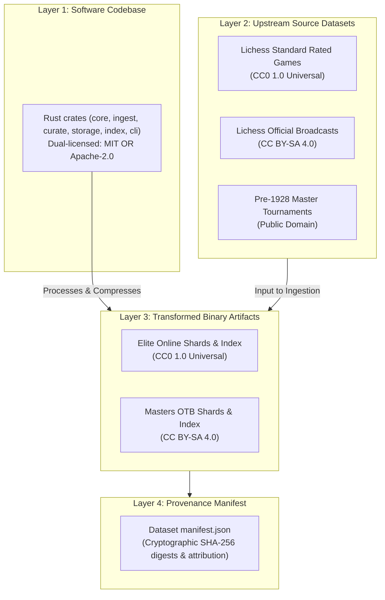

# Licensing and Data Provenance

## 1. Four-Layer Legal Architecture

To protect downstream consumers and maintain strict intellectual property boundaries, `chess-openings-db` segregates software logic, raw data inputs, compressed artifacts, and metadata provenance into four independent legal layers:

---

## 2. Software Codebase Licensing (`MIT` OR `Apache-2.0`)

All source code authored in this repository (`crates/core`, `crates/ingest`, `crates/curate`, `crates/storage`, `crates/index`, `crates/cli`, and associated build scripts) is dual-licensed:
- **[Apache License, Version 2.0](../LICENSE-APACHE)**
- **[MIT License](../LICENSE-MIT)**

Consumers and developers may use, embed, modify, and redistribute the software under either license at their option.

### Zero AGPL Code Reuse Principle
The reference Opening Explorer developed by Lichess (`lila-openingexplorer`) is licensed under the **GNU Affero General Public License v3.0 (AGPL-3.0)**.
- **Strict Clean-Room Boundary:** `chess-openings-db` contains **zero imported, translated, or derived code** from `lila-openingexplorer` or any AGPL codebase.
- All ingestion routines, binary container serialization (`CGB3`), external merge sort pipelines, and index querying engines were designed and authored independently from first principles.

---

## 3. Source Data Inventory and Classification Matrix

| Source | Publisher | Explicit License | Derivative Redistribution | Volume | Rating Pool | Classification |
| :--- | :--- | :--- | :--- | :--- | :--- | :--- |
| **Lichess Standard Rated Games** | Lichess.org | CC0 1.0 Universal | Unrestricted | >6 Billion | Lichess Glicko-2 | **Approved** (`elite-online`) |
| **Lichess Official Broadcasts** | Lichess.org | CC BY-SA 4.0 | Permitted with Attribution & ShareAlike | ~1.5 Million | FIDE Elo | **Approved** (`masters-otb`) |
| **Lichess Opening Names** | Lichess.org | CC0 1.0 Universal | Unrestricted | ~4,000 ECOs | N/A (Metadata) | **Approved** (ECO Reference) |
| **Pre-1928 Historical Archives** | Historical Public Domain | Public Domain | Unrestricted | ~150,000 | Historical Master | **Approved** (Historical OTB) |
| **The Week in Chess (TWIC)** | Mark Crowther | Proprietary / Restricted | Prohibited without written license | ~3.5 Million | FIDE Elo | **Excluded** |
| **PGN Mentor** | Attila Schneider | Unspecified (Personal use) | Prohibited without license | ~1.8 Million | FIDE Elo | **Excluded** |
| **Caissabase** | Caissabase.co.uk | Ambiguous (TWIC derivative) | High legal risk | ~5.0 Million | Mixed / FIDE | **Excluded** |
| **KingBase 2019** | Community mirror | Ambiguous / CC BY-SA claimed | Upstream provenance unverified | ~2.2 Million | FIDE Elo | **Excluded / Deferred** |
| **FIDE Official PGN Relays** | FIDE | Proprietary / Terms vary | Requires event-by-event permission | Varies | FIDE Elo | **Requires Explicit Permission** |

---

## 4. Dataset Licensing Framework & Redistribution Obligations

### 4.1 Elite Online Artifacts (`CC0 1.0 Universal`)
- **Upstream License:** Creative Commons CC0 1.0 Universal Public Domain Dedication.
- **Redistribution Rights:** Unrestricted worldwide public domain dedication. No attribution, copyleft, or royalty obligations apply to downstream users.
- **Derivative Works:** Curated `elite-online` shards and CPI indexes generated from Lichess rated archives are distributed under CC0 1.0.

### 4.2 Masters OTB Artifacts (`CC BY-SA 4.0`)
- **Upstream License:** Creative Commons Attribution-ShareAlike 4.0 International (CC BY-SA 4.0).
- **Attribution Requirement:** Any public distribution or deployment of the `masters-otb` dataset or Opening Explorer derived from it must provide visible attribution:
  > *"Masters OTB opening statistics and game records derived from Lichess.org Official Broadcasts, licensed under Creative Commons Attribution-ShareAlike 4.0 International (CC BY-SA 4.0)."*
- **ShareAlike Requirement:** Derivative datasets containing modified or expanded `masters-otb` data must be made available under CC BY-SA 4.0 or a compatible license.
- **Software Separation:** The CC BY-SA 4.0 license applies to the *data artifacts* (`shard_XXXX.cgb3`, `positions.cpi`), not to the software application or API service logic accessing them.

---

## 5. Compliance Checklist for Downstream Operators

When redistributing datasets generated by `chess-openings-db` or operating an Opening Explorer API service:
- [x] **Preserve License Headers:** Retain `LICENSE-MIT` and `LICENSE-APACHE` with code distributions.
- [x] **Isolate Collections:** Never merge `masters-otb` and `elite-online` into a single file or query output to prevent license contamination.
- [x] **Provide Attribution for Masters OTB:** Display the CC BY-SA 4.0 attribution notice in API documentation, about dialogs, or repository READMEs.
- [x] **Retain Manifest Integrity:** Distribute `manifest.json` alongside dataset shards to document cryptographic provenance and SHA-256 verification hashes.
