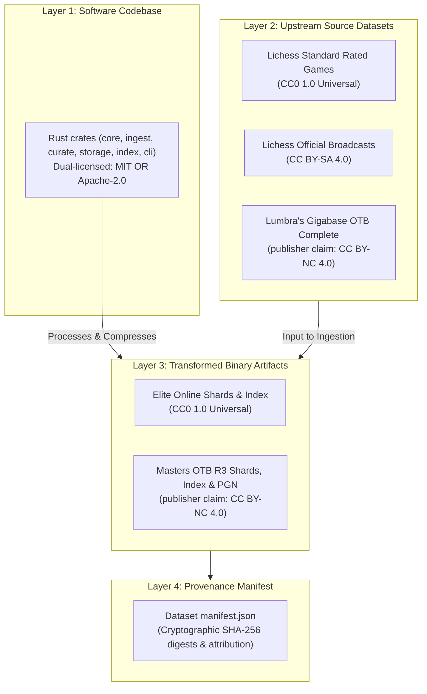

# Licensing and Data Provenance

> **Current policy in one line:** Masters OTB R3 is distributed for non-commercial use with attribution under the maintainer's recorded decision; Elite Online is a separate Lichess-derived dataset under CC0 1.0, including commercial use. Dataset licenses do not change the software's MIT OR Apache-2.0 terms. The Masters decision and its remaining open questions are in [section 6](#6-current-policy-for-the-masters-otb-dataset-and-public-deployment).

## 1. Four-Layer Legal Architecture

To protect downstream consumers and maintain strict intellectual property boundaries, `opening-explorer-api` segregates software logic, raw data inputs, compressed artifacts, and metadata provenance into four independent legal layers:

---

## 2. Software Codebase Licensing (`MIT` OR `Apache-2.0`)

All source code authored in this repository (`crates/core`, `crates/ingest`, `crates/curate`, `crates/storage`, `crates/index`, `crates/cli`, and associated build scripts) is dual-licensed:
- **[Apache License, Version 2.0](../LICENSE-APACHE)**
- **[MIT License](../LICENSE-MIT)**

Consumers and developers may use, embed, modify, and redistribute the software under either license at their option.

### Zero AGPL Code Reuse Principle
The reference Opening Explorer developed by Lichess (`lila-openingexplorer`) is licensed under the **GNU Affero General Public License v3.0 (AGPL-3.0)**.
- **Strict Clean-Room Boundary:** `opening-explorer-api` contains **zero imported, translated, or derived code** from `lila-openingexplorer` or any AGPL codebase.
- All ingestion routines, binary container serialization (`CGB3`), external merge sort pipelines, and index querying engines were designed and authored independently from first principles.

---

## 3. Source Data Inventory and Classification Matrix

| Source | Publisher | Explicit License | Derivative Redistribution | Volume | Rating Pool | Classification |
| :--- | :--- | :--- | :--- | :--- | :--- | :--- |
| **Lichess Standard Rated Games** | Lichess.org | CC0 1.0 Universal | Unrestricted | >6 Billion | Lichess Glicko-2 | **Approved** (`elite-online`) |
| **Lichess Official Broadcasts** | Lichess.org | CC BY-SA 4.0 | Permitted with Attribution & ShareAlike | ~1.5 Million | FIDE Elo | **Approved** (`masters-otb`) |
| **Lichess Opening Names** | Lichess.org | CC0 1.0 Universal | Unrestricted | ~4,000 ECOs | N/A (Metadata) | **Approved** (ECO Reference) |
| **Pre-1928 Historical Archives** | Historical Public Domain | Public Domain | Unrestricted | ~150,000 | Historical Master | **Approved in principle; not in the pinned catalog** (a concrete archive with verifiable provenance is required before use) |
| **The Week in Chess (TWIC)** | Mark Crowther | Proprietary / Restricted | Prohibited without written license | ~3.5 Million | FIDE Elo | **Excluded** |
| **PGN Mentor** | Attila Schneider | Unspecified (Personal use) | Prohibited without license | ~1.8 Million | FIDE Elo | **Excluded** |
| **Caissabase** | Caissabase.co.uk | Ambiguous (TWIC derivative) | High legal risk | ~5.0 Million | Mixed / FIDE | **Excluded** |
| **KingBase 2019** | Community mirror | Ambiguous / CC BY-SA claimed | Upstream provenance unverified | ~2.2 Million | FIDE Elo | **Excluded / Deferred** |
| **FIDE Official PGN Relays** | FIDE | Proprietary / Terms vary | Requires event-by-event permission | Varies | FIDE Elo | **Requires Explicit Permission** |
| **Lumbra's Gigabase OTB Complete** | Lumbra's Gigabase | Publisher claims CC BY-NC 4.0; heterogeneous upstream records | Publisher-stated CC BY-NC 4.0: non-commercial sharing with attribution and indicated changes; source-level rights for every upstream record are not independently cleared; see section 4.4 | >13 million (publisher claim) | Publisher-supplied Elo | **Active Masters release (R3); non-commercial use with attribution; see section 6** |

The Elite Online R1 selection contains 429,150 canonical games from the seven periods listed in section 4.1. This release covers selected months from 2015–2017; it does not represent current Lichess play.

---

## 4. Dataset Licensing Framework & Redistribution Obligations

### 4.1 Elite Online Artifacts (`CC0 1.0 Universal`)
- **Source:** Lichess standard rated game archives, listed in the [official archive catalog](https://database.lichess.org/standard/). The pinned source periods for Elite Online R1 are **2015-09, 2015-12, 2016-03, 2016-06, 2016-09, 2016-12, and 2017-03**. Each archive and its publisher-provided SHA-256 are recorded in [`corpus/catalog.json`](../corpus/catalog.json).
- **License:** Lichess states that its database exports are released under the [Creative Commons CC0 1.0 Universal Public Domain Dedication](https://creativecommons.org/publicdomain/zero/1.0/). The catalog records that statement and license URL.
- **Redistribution:** The curated Elite Online R1 dataset and its filtered PGN are distributed under CC0 1.0. CC0 carries no attribution, non-commercial, or share-alike condition, so redistribution, including commercial redistribution, is permitted under that dedication.
- **Curation:** Opening Explorer applies the pinned Elite policy to standard rated games: each player has a Lichess Glicko-2 rating of at least 2200, or one has at least 2400 and the opponent at least 2000; bullet and ultrabullet, casual games, non-standard variants, games shorter than six plies, and explicitly disqualifying termination records are excluded. Duplicate games are identified and deduplicated, including prefix supersession. Accepted games are stored as legal canonical mainlines with supported metadata and indexed to 30 plies. The source archives themselves are not redistributed.
- **Software separation:** The Opening Explorer API software remains separately licensed under MIT OR Apache-2.0. Neither software license applies to the dataset, and CC0 does not relicense the software.

### 4.2 Historical Lichess Masters Artifacts (`CC BY-SA 4.0`)
- **Upstream License:** Creative Commons Attribution-ShareAlike 4.0 International (CC BY-SA 4.0).
- **Attribution Requirement:** Any public distribution or deployment of the `masters-otb` dataset or Opening Explorer derived from it must provide visible attribution:
  > *"Masters OTB opening statistics and game records derived from Lichess.org Official Broadcasts, licensed under Creative Commons Attribution-ShareAlike 4.0 International (CC BY-SA 4.0)."*
- **ShareAlike Requirement:** Derivative datasets containing modified or expanded `masters-otb` data must be made available under CC BY-SA 4.0 or a compatible license.
- **Software Separation:** The CC BY-SA 4.0 license applies to the *data artifacts* (`shard_XXXX.cgb3`, `positions.cpi`), not to the software application or API service logic accessing them.

### 4.3 Release Artifacts and Notices

Every release produced by `scripts/corpus.sh build` carries its own legal notice and provenance record in `RELEASE/`:
- `RELEASE/DATASET_LICENSE.txt`: the license name and URL, the required attribution statement, the list of changes made to the source data, and the ShareAlike obligation (Masters) or the CC0 provenance note (Elite). It states explicitly that the software license (MIT OR Apache-2.0) does not apply to the dataset and that no claim is made for material outside the listed archives.
- `RELEASE/RELEASE.json`: collection, dataset version, input archive names and publisher-verified SHA-256 checksums, curation-policy version, license identifier, artifact hashes, and the exact build/verify/serve commands.

Release archives produced by `corpus.sh package` include these files unchanged. The license statements for the two Lichess sources are taken from [database.lichess.org](https://database.lichess.org/) and recorded in `corpus/catalog.json` (`licenses.*.statement_source`). The catalog refuses to fetch or build from any source whose license is not marked `approved` or is not in the collection's `allowed_licenses`. **This is an engineering control, not legal advice**: whether statistical aggregates (the CPI index) count as an adaptation for ShareAlike purposes should be confirmed by the distributing party. The conservative position, adopted by the release notice, is to treat the Masters CPI as covered.

Containerization does not change source terms, and a deployment is not itself a dataset release. Preserve each version's `RELEASE/` notices and provenance. The historical Lichess Masters version carries CC BY-SA 4.0 attribution requirements; Gigabase R3 carries the publisher's CC BY-NC 4.0 terms and unresolved upstream rights, with current policy in [section 6](#6-current-policy-for-the-masters-otb-dataset-and-public-deployment). Elite Online R1 remains separately governed by CC0 1.0. See [DOCKER_DEPLOYMENT.md](DOCKER_DEPLOYMENT.md) for the operator workflow.

### 4.4 Lumbra's Gigabase Masters dataset

The [publisher's download page](https://lumbrasgigabase.com/en/download-area-en/) lists OTB Complete version 2026-11-11 as one PGN containing its other OTB PGN files except LichessBroadcastDB, and shows CC BY-NC 4.0 terms. The reviewed page displayed no publisher archive checksum. Its [sources page](https://lumbrasgigabase.com/en/sources/) identifies player-provided datasets, community projects, independent collections, legacy software dumps, federation records, academic datasets, and historical archives. It says reliable or binding license information is unavailable for some abandoned independent collections and historical archives. These statements do not clear every upstream record.

The publisher's [B2B terms page](https://lumbrasgigabase.com/en/commercial-licenses-en/) currently describes free internal development and a closed beta with at most 50 non-paying testers for up to six months. It permits internal derived metadata and prohibits end-user bulk exports and direct downloads of raw PGN files. The page says commercial license fees apply when a project goes live and becomes accessible to end users; its registration form also lists non-commercial use. The page asks developers to register a project or request a license, but does not specify whether a public non-commercial product or per-game PGN endpoint is permitted under those conditions. These are the publisher's statements as reviewed on 2026-11-15. They are preserved here as an external observation; how the project reads them is recorded in [section 6](#6-current-policy-for-the-masters-otb-dataset-and-public-deployment).

The official [CC BY-NC 4.0 deed](https://creativecommons.org/licenses/by-nc/4.0/) allows sharing and adaptation with attribution, a license link, and an indication of changes, while excluding commercial use. It also notes that additional permissions may be needed. The publisher's current CC BY-NC claim does not independently establish rights in heterogeneous upstream material. A machine-readable capture of the reviewed page claims and unresolved questions is in [`benchmarks/gigabase/PUBLISHER_TERMS_REVIEW.json`](../benchmarks/gigabase/PUBLISHER_TERMS_REVIEW.json).

The local `.7z` extraction path records hashes computed from the supplied archive and its extracted PGN. It leaves `publisher_checksum` empty and marks the source ineligible for the approved catalog. The `scripts/local_gigabase_eval.py` workflow built the R3 snapshot; `scripts/promote_gigabase_r3.py` verifies and atomically publishes that existing snapshot without rebuilding. The package repeats the publisher's CC BY-NC 4.0 claim, keeps upstream rights unresolved, and excludes the archive and PGN. Neither a `Source` tag nor the publisher's aggregate license statement establishes redistribution permission for every included upstream record. **Historical operating posture:** when R3 was first promoted, the project ran it only as a private evaluation deployment with raw-PGN retrieval disabled and treated public service and redistribution as unauthorized. The maintainer's later decisions of 2026-11-16 (section 6) supersede that posture as current policy; the earlier evidence is preserved unchanged. The prior Lichess Masters version is retained separately for rollback.

---

## 5. Compliance Checklist for Downstream Operators

When redistributing datasets generated by `opening-explorer-api` or operating an Opening Explorer API service:
- [x] **Preserve License Headers:** Retain `LICENSE-MIT` and `LICENSE-APACHE` with code distributions.
- [x] **Isolate Collections:** Never merge `masters-otb` and `elite-online` into a single file or query output to prevent license contamination.
- [x] **Provide Attribution for Masters OTB:** Display the attribution notice for the release you serve (section 6 for Gigabase R3; the CC BY-SA 4.0 notice for the retained historical Lichess Masters version) in API documentation, about dialogs, or repository READMEs.
- [x] **Retain Manifest Integrity:** Distribute `manifest.json` alongside dataset shards to document cryptographic provenance and SHA-256 verification hashes.

---

## 6. Current policy for the Masters OTB dataset and public deployment

This section is the single authoritative statement of current policy. Other documents link here instead of restating it.

### 6.1 Decision records

| Record | Decides | Date |
| :--- | :--- | :--- |
| [`releases/distribution_clearance.json`](../releases/distribution_clearance.json) | Non-commercial GitHub Release distribution of the `masters-otb-r3` indexed dataset and filtered PGN. Unchanged. | 2026-11-16 |
| [`releases/public_deployment_decision.json`](../releases/public_deployment_decision.json) | Public, non-commercial deployment of the API, including position statistics and individual game retrieval. | 2026-11-16 |

Both rest on the same basis: the publisher's publicly stated CC BY-NC 4.0 license, as read by the maintainer. They are the maintainer's interpretation, **not separate written permission from the publisher** and not independent legal clearance. This project has no private correspondence with the publisher to cite.

### 6.2 What is covered

| Use | Status |
| :--- | :--- |
| Download and use the published release products (indexed dataset, filtered PGN) for non-commercial purposes | Covered ([release](https://github.com/Nerver-zip/opening-explorer-api/releases/tag/dataset-masters-otb-r3)) |
| Run a public, non-commercial instance of the API serving position statistics, move frequencies, and W/D/L | Covered |
| Serve single games as PGN with `GET /v1/collections/{collection}/games/{id}` in a public instance | Covered. Retrieval is enabled by default. Operators may switch it off, but the project does not require or recommend that for this dataset |
| Bulk export of games through the API | Not provided. No bulk-download endpoint exists, and none is part of this decision |
| Commercial use of the dataset or of a service or product built on it | **Not covered.** It needs separate rights from the publisher and the upstream holders |

Elite Online is separately released under [CC0 1.0](https://creativecommons.org/publicdomain/zero/1.0/), with no attribution or non-commercial condition. Its provenance and 2015–2017 source periods are documented in section 4.1.

### 6.3 Terms for applications and operators

An application, service, or person that uses the Masters OTB data or an instance serving it is inside the maintainer's decision only if all of the following hold:

1. **Non-commercial use only.** Anything that is sold, monetized, or part of a commercial offering is outside the decision.
2. **Attribution.** Show the acknowledgment below where the data or its statistics are shown (an about page, footer, or documentation is enough), with a link to the license.
3. **No endorsement and no authorship claim.** Do not suggest the publisher endorses your application, and do not claim authorship of any game. The games remain the work of their players, organizers, and publishers.
4. **Indicate changes.** Say that the data was filtered, deduplicated, normalized, and indexed (the changes below).
5. **Keep the dataset and software terms apart.** The software is MIT OR Apache-2.0. That license does not apply to the data.

Operators of public instances should also keep the controls described in [DOCKER_DEPLOYMENT.md](DOCKER_DEPLOYMENT.md): read-only dataset mounts, a protected or disabled admin endpoint, and resource limits.

**Required acknowledgment:**

> Masters OTB games and derived opening statistics from Lumbra's Gigabase, OTB Complete version 2026-11-11 (publisher claim: CC BY-NC 4.0, https://creativecommons.org/licenses/by-nc/4.0/). Curated, filtered, normalized, and indexed by the Opening Explorer API project. Not endorsed by the publisher.

### 6.4 Changes made to the publisher's data

Selection under the Masters OTB policy, deduplication and prefix supersession, re-serialization of each game as a legal mainline with a fixed metadata tag set, and a position index. The package notice lists the changes in full and states which metadata is not preserved. The publisher's original data and this project's derivatives are distinct: the published assets are derivatives, not the publisher's archive.

### 6.5 Remaining discrepancies and limits (disclosed, not resolved)

These are the facts that the adopted interpretation does not remove:

- **Publisher B2B terms.** The publisher's [B2B page](https://lumbrasgigabase.com/en/commercial-licenses-en/) prohibits end-user bulk exports and direct downloads of raw PGN files. It does not say whether a public non-commercial product or a per-game endpoint is allowed, and the publisher has not confirmed the maintainer's reading. The published filtered PGN is a bulk download, and the game endpoint returns raw PGN, so both are mechanisms that wording addresses. The decisions above choose to rely on the CC BY-NC grant for them.
- **Upstream rights.** The publisher says some upstream collections have no reliable license information. Rights in individual games are not verified, and the `Source` tag does not establish them.
- **No publisher checksum.** Local hashes of the archive and extracted PGN are not publisher-authenticated.
- **Immutable earlier notices.** The R3 snapshot's `RELEASE/DATASET_LICENSE.txt` (local internal evaluation only), its `RELEASE.json` (`public_release_eligible: false`, `rights_clearance: unresolved_upstream_rights`), and the published `masters-otb-r3-NOTICE.md` ("not_cleared" at packaging) were written before the decisions and are checksummed. They are preserved unmodified and are superseded as current policy by section 6.1.
- **Source catalog.** `corpus/catalog.json` still lists Gigabase outside the approved source catalog. That is a build-tooling control and does not govern use of the published release.
- **Commercial use** is outside the clearance (section 6.2).

### 6.6 Chronology

| When | Event |
| :--- | :--- |
| 2026-11-15 | Publisher terms reviewed and recorded (`benchmarks/gigabase/PUBLISHER_TERMS_REVIEW.json`). |
| Before 2026-11-16 | R3 built and promoted as a private evaluation deployment with raw-PGN retrieval disabled. Evidence in `benchmarks/gigabase/`. |
| 2026-11-16 | Maintainer records the distribution clearance; `dataset-masters-otb-r3` is published. |
| 2026-11-16 | Maintainer records the public, non-commercial deployment decision (section 6.1). |
