# Project Roadmap & Milestones

This document tracks completed milestones, delivered capabilities, and planned engineering initiatives for `chess-openings-db`.

---

## 1. Milestone Delivery Status

```mermaid
flowchart LR
    M1["Stage A: Feasibility Prototype<br/>(COMPLETED)"] --> M2["Stage B: Bounded Ingestion & CGB3<br/>(COMPLETED)"]
    M2 --> M3["PR-03: Production CPI v2 Index<br/>(COMPLETED)"]
    M3 --> M4["Governance & Standards Alignment<br/>(COMPLETED)"]
    M4 --> M5["PR-04: Opening Explorer HTTP API<br/>(COMPLETED)"]
    M5 --> M5b["PR-A: Reproducible Corpus Release & Local Delivery<br/>(DELIVERED)"]
    M5b --> M5c["PR #6: Dockerized Opening Explorer & event-qualified Masters release<br/>(COMPLETED)"]
    M5c --> M5d["PR #7: Locally supplied Gigabase evaluation<br/>(LOCAL EVALUATION COMPLETE; REVIEW PENDING)"]
    M5d --> M6["Future: Advanced distribution and classification<br/>(PLANNED)"]
```

| Milestone | Target Scope | Status | Primary Artifacts |
| :--- | :--- | :--- | :--- |
| **Stage A: Feasibility & In-Memory Prototype** | Empirical feasibility analysis, move packing (16-bit), initial dictionary compression, heuristic Heaps' Law scaling. | **Completed** | [ADR-0001](adr/0001-initial-architecture.md), [`docs/research/feasibility-report.md`](research/feasibility-report.md), Stage A benchmark fixture. |
| **Stage B / PR-01 / PR-02: Bounded Ingestion & Persistent CGB3** | $O(1)$ RAM streaming ingestion with per-process RSS measurement, disk-backed deduplication, multi-shard packaging (`shard_XXXX.cgb3`), global binary search index (`games.idx`), atomic publication, and crash recovery. | **Completed** | [ADR-0002](adr/0002-bounded-ingestion-and-persistent-cgb3-archive.md), `codb-storage`, `crates/storage/tests/publication_tests.rs`. |
| **PR-03: Production CPI v2 Index** | Bounded-memory external sorting pipeline (`ExternalPositionIndexer`), temporary run files (`.crun`), deterministic K-way merge, CPI v2 container (`positions.cpi`), mmap sparse index, and CLI Opening Explorer queries. | **Completed** | [ADR-0003](adr/0003-production-cpi-index.md), `codb-index`, `benchmarks/production_cpi/`. |
| **Governance & Quality Standardization** | Standardized engineering governance: `AGENTS.md`, `HANDOFF.md`, canonical docs re-architecture, benchmark sanitization, doc link validator, and CI hardening. | **Completed** | [docs/ARCHITECTURE.md](ARCHITECTURE.md), [docs/DATA_CONTRACTS.md](DATA_CONTRACTS.md), `scripts/validate.sh`, `scripts/validate_docs.py`. |
| **PR-04: Opening Explorer Read-Only HTTP API** | Production-ready HTTP query service (`codb-api`), `codb serve` command, lock-free CPI reads, pooled PGN decompression, atomic reload, and integration suites. | **Completed** | [ADR-0004](adr/0004-opening-explorer-http-api.md), `codb-api`, [docs/DATA_CONTRACTS.md#6](DATA_CONTRACTS.md#6-opening-explorer-http-api-contract). |
| **PR-A: Reproducible Corpus Release** | Pinned source catalog, verified acquisition, release build/index/verify/package tooling, and local API checks. | **Delivered** | corpus/catalog.json, scripts/corpus.py, scripts/corpus.sh, [CORPUS_BUILD.md](CORPUS_BUILD.md). |
| **PR #6: Dockerized Opening Explorer & event-qualified Masters release** | Independent API image, Compose deployment, verified package bootstrap, shared Docker network, exact event-level Masters audit, atomic version switch, and real-corpus container evidence. | **Completed** | [DOCKER_DEPLOYMENT.md](DOCKER_DEPLOYMENT.md), scripts/audit_masters_events.py, scripts/docker_smoke.py. |
| **PR #7: Locally supplied Gigabase qualification** | Structural inventory, opt-in source and identity gates, a checksummed attribution sidecar outside CGB3, safe local `.7z` extraction, and a deterministic 183,907-game local evaluation served in Docker. A publisher checksum and cleared upstream redistribution rights are still required before this can become an approved public release. | **Local evaluation complete; Draft PR review pending** | [`benchmarks/gigabase/FINAL_REPORT.md`](../benchmarks/gigabase/FINAL_REPORT.md), `corpus/gigabase_source_qualification.json`, `scripts/corpus.py`, `crates/storage/src/dataset.rs`. |
| **Future: Replication & Precomputed ECO Trees** | Incremental dataset replication, CDN-friendly block distribution, and precomputed ECO opening classification trees. | **Planned** | Standalone tooling and index enhancements. |

---

## 2. Completed Capabilities (Current Baseline)

The current baseline of `chess-openings-db` delivers:
- **Streaming PGN Ingestion (`codb-ingest`):** Transparent Zstd decompression, streaming token parsing, and 100% legal move replay via `shakmaty`.
- **Policy Filtering & Deduplication (`codb-curate`):** Strict separation of `masters-otb` and `elite-online`, bullet time control exclusion ($T_{\text{est}} < 180\text{s}$), normalized metadata keys, move-slice prefix supersession, and disk-backed deduplication.
- **Persistent Sharded Storage (`codb-storage`):** `CGB3` block-level dictionary interning, `shard_XXXX.cgb3` container splitting, 16-byte fixed-record `games.idx` binary search, process-level advisory flock, and atomic symlink publication with snapshot isolation.
- **Production Position Index (`codb-index`):** Bounded-memory external sorting indexer (`ExternalPositionIndexer`), temporary run file emission (`.crun`), deterministic K-way merge, CPI v2 (`positions.cpi`), zero-allocation memory-mapped sparse index ($34\text{ B/entry}$), and functional Opening Explorer queries.
- **Production HTTP Serving Layer (`codb-api` & `codb serve`):** Asynchronous Axum/Tokio HTTP service providing zero-copy position lookups, collection-qualified PGN retrieval, zero-downtime hot reloading, CORS/trace/timeout middleware, and p50 latencies under 300 µs at < 10 MB RAM.

---

### 2.1 Full-Scale Corpus Expansion (Future)

The delivered baseline is a reproducible, provenance-verified corpus of the scale documented in [CORPUS_BUILD.md](CORPUS_BUILD.md). The original 5M Masters / 10M Elite goal remains a future expansion that needs additional approved sources (Masters) and tens of gigabytes of Lichess standard archives (Elite). It is not a completion criterion of any delivered milestone. Publishing release archives to an approved hosting destination is likewise future work.

---

## 3. Future Roadmap: Advanced Indexing & Distribution

With the HTTP API daemon delivered, future development cycles focus on:

### 3.1 Advanced Distribution and Incremental Updates
- **Incremental Dataset Updates:** Append-only delta shards and differential CPI merges avoiding full re-indexing of multi-million game collections.
- **CDN Block Cache Optimization:** Content-addressable chunking for `positions.cpi` blocks to support direct edge serving.

### 3.2 Opening Tree Enhancements
- **Precomputed ECO & Opening Names:** Fast header-level ECO code tagging and canonical opening name lookups attached to position candidate branches.
- **Evaluation Cache Integration:** Optional sidecar attachment point for precomputed Stockfish evaluation depths alongside move candidate frequencies.

---

## 4. Historical Research Note

Initial feasibility investigations and early storage layout comparisons are archived in:
- [`docs/research/feasibility-report.md`](research/feasibility-report.md) — Initial empirical feasibility and Heaps' Law parameter exploration.
- [`docs/research/storage-options.md`](research/storage-options.md) — Trade-off matrix comparing SQLite, RocksDB, flat binary blocks, and CGB containers.

These research reports are maintained for historical provenance and reproducibility; authoritative production behavior is defined in the canonical documents indexed in [docs/README.md](README.md).
