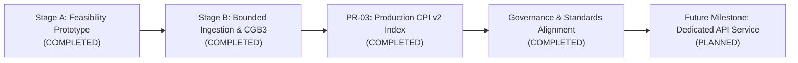

# Project Roadmap & Milestones

This document tracks completed milestones, delivered capabilities, and planned engineering initiatives for `chess-openings-db`.

---

## 1. Milestone Delivery Status

| Milestone | Target Scope | Status | Primary Artifacts |
| :--- | :--- | :--- | :--- |
| **Stage A: Feasibility & In-Memory Prototype** | Empirical feasibility analysis, move packing (16-bit), initial dictionary compression, heuristic Heaps' Law scaling. | **Completed** | [ADR-0001](adr/0001-initial-architecture.md), [`docs/research/feasibility-report.md`](research/feasibility-report.md), Stage A benchmark fixture. |
| **Stage B / PR-01 / PR-02: Bounded Ingestion & Persistent CGB3** | $O(1)$ RAM streaming ingestion ($<30\text{ MB}$ RSS), disk-backed deduplication, multi-shard packaging (`shard_XXXX.cgb3`), global binary search index (`games.idx`), atomic publication, and crash recovery. | **Completed** | [ADR-0002](adr/0002-bounded-ingestion-and-persistent-cgb3-archive.md), `codb-storage`, `crates/storage/tests/publication_tests.rs`. |
| **PR-03: Production CPI v2 Index** | Bounded-memory external sorting pipeline (`ExternalPositionIndexer`), temporary run files (`.crun`), deterministic K-way merge, CPI v2 container (`positions.cpi`), mmap sparse index, and CLI Opening Explorer queries. | **Completed** | [ADR-0003](adr/0003-production-cpi-index.md), `codb-index`, `benchmarks/production_cpi/`. |
| **Governance & Quality Standardization** | Standardized engineering governance: `AGENTS.md`, `HANDOFF.md`, canonical docs re-architecture, benchmark sanitization, doc link validator, and CI hardening. | **Completed** | [docs/ARCHITECTURE.md](ARCHITECTURE.md), [docs/DATA_CONTRACTS.md](DATA_CONTRACTS.md), `scripts/validate.sh`, `scripts/validate_docs.py`. |
| **Future: Standalone Opening Explorer HTTP/gRPC Service** | Lightweight, independently deployable read-only daemon serving sub-millisecond Opening Explorer and game retrieval queries over HTTP/JSON and gRPC. | **Planned** | [docs/DATA_CONTRACTS.md#6](DATA_CONTRACTS.md#6-future-http-opening-explorer-api-contract). |

---

## 2. Completed Capabilities (Current Baseline)

The current baseline of `chess-openings-db` delivers:
- **Streaming PGN Ingestion (`codb-ingest`):** Transparent Zstd decompression, streaming token parsing, and 100% legal move replay via `shakmaty`.
- **Policy Filtering & Deduplication (`codb-curate`):** Strict separation of `masters-otb` and `elite-online`, bullet time control exclusion ($T_{\text{est}} < 180\text{s}$), normalized metadata keys, move-slice prefix supersession, and disk-backed deduplication.
- **Persistent Sharded Storage (`codb-storage`):** `CGB3` block-level dictionary interning (~208 B/game for Masters OTB, ~178–181 B/game for Elite Online), `shard_XXXX.cgb3` container splitting, 16-byte fixed-record `games.idx` binary search, process-level advisory flock, and atomic symlink publication with snapshot isolation.
- **Production Position Index (`codb-index`):** Bounded-memory external sorting indexer (`ExternalPositionIndexer`), temporary run file emission (`.crun`), deterministic K-way merge, CPI v2 (`positions.cpi`), zero-allocation memory-mapped sparse index ($34\text{ B/entry}$), and functional Opening Explorer queries.

---

## 3. Future Roadmap: Opening Explorer API Service

The next major developmental cycle focuses on building the standalone API service:

### 3.1 Architecture of the API Daemon
- **Embedded Engine:** Built in Rust using `axum` or `actix-web` (or lightweight daemon integration).
- **Zero-Copy Serving:** Memory-maps `positions.cpi` and `games.idx` directly into process virtual memory, leveraging OS page caching with zero heap duplication.
- **Read-Only Snapshot Pinning:** The daemon pins the active dataset snapshot directory on startup. If a newly published dataset version appears (`current` symlink updated), the daemon detects the update via inotify or background polling and smoothly transitions connections without downtime.

### 3.2 Endpoints and Features
- `GET /v1/explorer/position`: Canonical position query by FEN or move sequence with collection isolation.
- `GET /v1/explorer/game/{id}`: Sub-millisecond game retrieval by stable 64-bit ID.
- `GET /v1/explorer/metadata`: Health, dataset freshness, manifest statistics, and memory usage metrics.
- Client caching headers: `ETag` based on dataset manifest SHA-256 and aggressive `Cache-Control: public, max-age=86400`.

---

## 4. Historical Research Note

Initial feasibility investigations and early storage layout comparisons are archived in:
- [`docs/research/feasibility-report.md`](research/feasibility-report.md) — Initial empirical feasibility and Heaps' Law parameter exploration.
- [`docs/research/storage-options.md`](research/storage-options.md) — Trade-off matrix comparing SQLite, RocksDB, flat binary blocks, and CGB containers.

These research reports are maintained for historical provenance and reproducibility; authoritative production behavior is defined in the canonical documents indexed in [docs/README.md](README.md).
