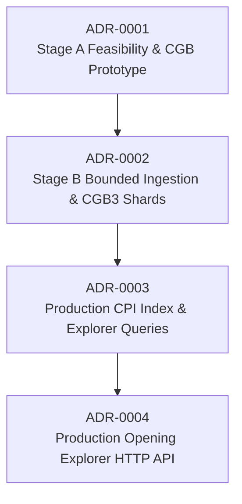

# Architecture Decision Records (ADRs)

This directory maintains the historical and normative Architecture Decision Records for the `opening-explorer-api` project. Each ADR documents a significant architectural decision, its motivating context, evaluated alternatives, and consequences.

## Decision Register

| ADR | Title | Status | Date | Primary Scope |
| :--- | :--- | :--- | :--- | :--- |
| [ADR-0001](0001-initial-architecture.md) | Initial Architecture, Storage, and Indexing Foundations | Superseded by ADR-0002 / ADR-0003 | 2026-10-23 | Workspace structure, initial CGB block layout, 16-bit move packing, collection separation (`masters-otb` vs `elite-online`), and licensing. |
| [ADR-0002](0002-bounded-ingestion-and-persistent-cgb3-archive.md) | Scalable Bounded-Memory Ingestion, Persistent CGB3 Container Sharding, and Global Game Lookup | Accepted | 2026-10-25 | Incremental streaming pipeline ($O(1)$ RAM), disk-backed deduplication, persistent `shard_XXXX.cgb3` container, binary search `games.idx`, and atomic publication. |
| [ADR-0003](0003-production-cpi-index.md) | Production Chess Position Index (CPI v2) — Bounded-Memory External Sorting, Deterministic Aggregation, Atomic Publication & Explorer Queries | Accepted | 2026-11-04 | Bounded-memory external merge sort pipeline, temporary run files (`.crun`), deterministic K-way merge, CPI v2 (`positions.cpi`), sparse index mmap lookup, and Opening Explorer queries. |
| [ADR-0004](0004-opening-explorer-http-api.md) | Production-Ready Opening Explorer HTTP API — Axum Serving Layer, Snapshot Pinning & Lock-Free Concurrent Queries | Accepted | 2026-11-06 | Dedicated `opening-explorer-api` crate, `opening-explorer serve` CLI command, Axum HTTP layer, snapshot pinning with zero tearing, lock-free CPI reads, pooled game decompression, and defensive validation. |

---

## Evolution of the Architecture

For current end-to-end architecture and runtime guarantees, see [docs/ARCHITECTURE.md](../ARCHITECTURE.md). For data contracts and binary serialization specifications, see [docs/DATA_CONTRACTS.md](../DATA_CONTRACTS.md).
